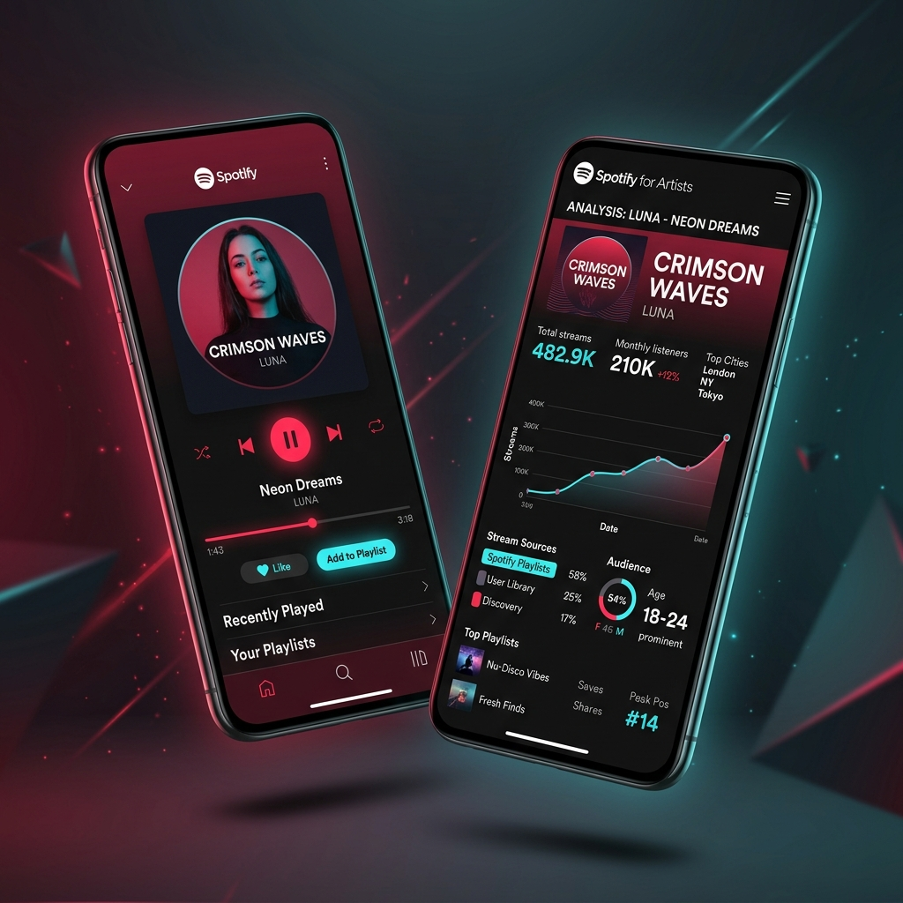
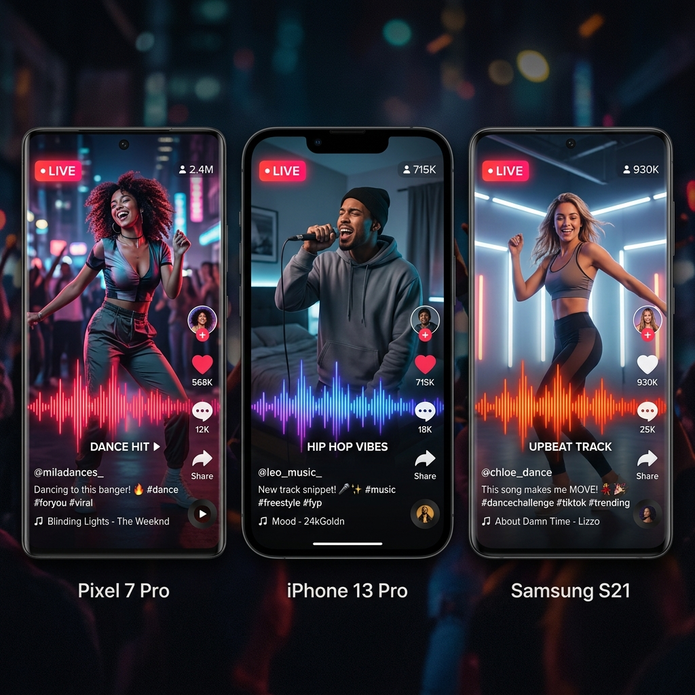
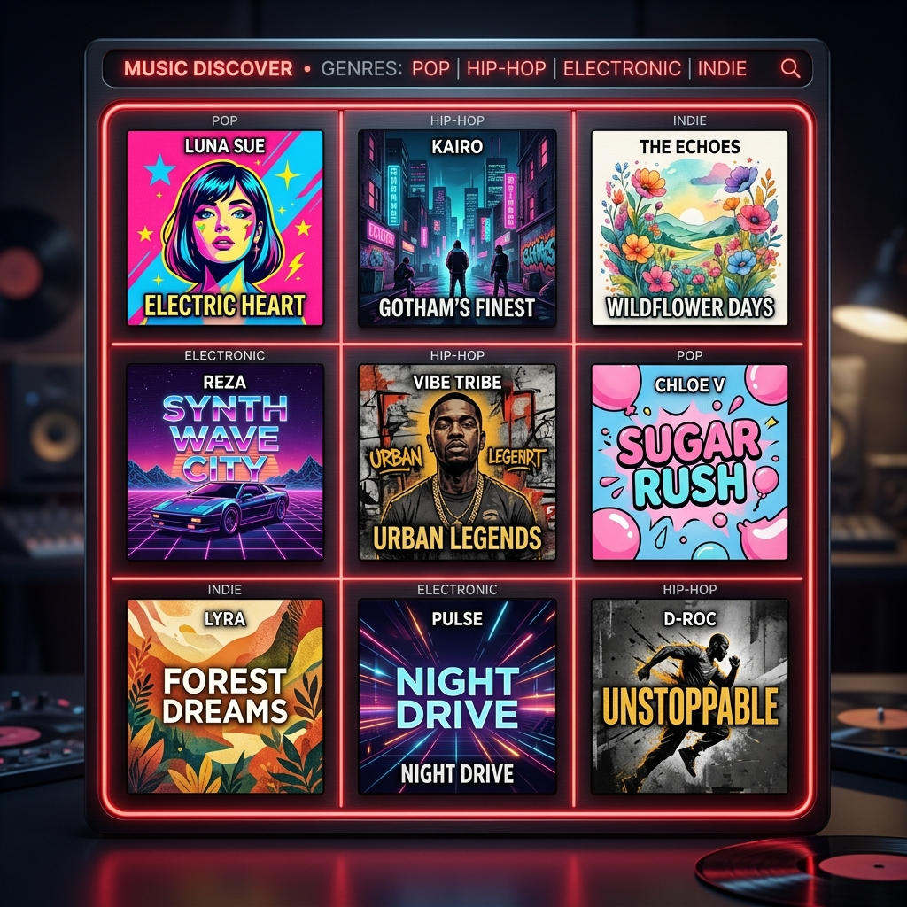
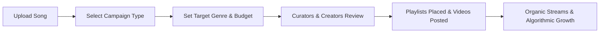

  

<h1 align="center">SoundReach.me — Real Music Promotion & Playlist Placement Marketplace</h1>

  <strong>Connect your music directly with vetted Spotify playlist curators and viral TikTok creators. Real listeners, genuine streams, and organic reach.</strong>

  
  
  
  
  
  

---

## 📌 Table of Contents
- [✨ What is SoundReach.me?](#-what-is-soundreachme)
- [🎯 For Artists & Record Labels](#-for-artists--record-labels)
  - [🎧 Spotify Playlist Promotion](#-spotify-playlist-promotion)
  - [📱 TikTok Sound Drops & Creator Campaigns](#-tiktok-sound-drops--creator-campaigns)
  - [📊 Live Analytics & Campaign Dashboard](#-live-analytics--campaign-dashboard)
- [💰 For Creators & Playlist Curators](#-for-creators--playlist-curators)
  - [🟢 Spotify Curator Program](#-spotify-curator-program)
  - [🟣 TikTok Creator Program](#-tiktok-creator-program)
- [⚡ Why SoundReach.me?](#-why-soundreachme)
- [🚀 How It Works](#-how-it-works)
- [💳 Campaign Tiers & Budgets](#-campaign-tiers--budgets)
- [❓ Frequently Asked Questions (FAQ)](#-frequently-asked-questions-faq)
- [🌐 Connect & Get Started](#-connect--get-started)

---

## ✨ What is SoundReach.me?

**[SoundReach.me](https://soundreach.me)** is the modern music promotion marketplace built to bridge the gap between independent musicians, record labels, and active tastemakers. 

Breaking a song today requires more than just uploading to DSPs—it requires authentic listener traction. SoundReach.me delivers **direct, transparent access** to:
1. **Verified Spotify Playlist Curators** with engaged, active follower bases.
2. **High-Impact TikTok Creators** ready to use your official sound in their original video content.

No bot networks. No fake play farms. No black-box promises. Just real creators, honest curator feedback, and measurable organic momentum.

  
  &nbsp;&nbsp;&nbsp;&nbsp;
  

---

## 🎯 For Artists & Record Labels

### 🎧 Spotify Playlist Promotion
Place your tracks directly in front of independent playlist curators who actively listen to and curate music in your specific genre:
- **Targeted Genre Matching**: Pitch directly to curators specializing in Hip Hop, Pop, R&B, EDM, Indie Rock, Lo-Fi, Latin, Country, Afrobeats, and more.
- **Guaranteed Curator Review**: Every submission is sent directly to matching curators who review your song and provide honest, constructive feedback.
- **Trigger Algorithmic Growth**: Organic streams and playlist adds signal positive listener behavior to Spotify's algorithms, helping unlock **Release Radar**, **Discover Weekly**, and **Spotify Radio**.

### 📱 TikTok Sound Drops & Creator Campaigns
Harness the power of short-form viral video to skyrocket your sound's popularity:
- **Direct Creator Matching**: Send your official TikTok sound to verified creators across comedy, dance, lifestyle, fitness, and aesthetic niches.
- **User-Generated Content (UGC) Cascades**: Each video submission creates authentic content that exposes your track to thousands of engaged followers.
- **Viral Discovery Pipeline**: Drive massive spikes on TikTok audio pages, boosting Shazam searches, Apple Music lookups, and Spotify saves.

### 📊 Live Analytics & Campaign Dashboard
Gain complete visibility over every promotional dollar spent:
- Track real-time playlist adds, track reviews, and placement durations.
- Monitor TikTok video submissions, creator links, and aggregate view milestones.
- Export campaign performance summaries for your management team or label partners.

  

---

## 💰 For Creators & Playlist Curators

Turn your ear for music and your social audience into reliable income while discovering the next big hit before anyone else.

### 🟢 Spotify Curator Program
- **Monetize Your Playlists**: Earn paid rewards for reviewing new music submissions and considering them for your playlists.
- **Full Curatorial Freedom**: You retain 100% control over whether a song fits your playlist aesthetic. Honest opinions are always prioritized.
- **Automated Payouts**: Fast, seamless balance withdrawals with transparent tracking per review.
- **Apply Here**: [SoundReach Spotify Curator Program](https://soundreach.me/spotify-curator-program)

### 🟣 TikTok Creator Program
- **Get Paid to Make Content**: Choose from a library of active music campaigns and earn cash for using official sounds in your videos.
- **Transparent View Tiers**: Payouts scale with your video's verified organic view count.
- **Zero Friction**: Submit your video link directly in the SoundReach dashboard for automated verification.
- **Apply Here**: [SoundReach TikTok Creator Application](https://soundreach.me/apply)

---

## ⚡ Why SoundReach.me?

| Feature | SoundReach.me | Traditional Promo / PR Agencies | "Payola" & Bot Services |
| :--- | :---: | :---: | :---: |
| **Stream Authenticity** | **100% Real, Active Listeners** | Variable | ❌ Fake Bots / Artificial |
| **TOS Compliance** | **Spotify & TikTok Compliant** | Compliant | ❌ Violates TOS (Risk of Ban) |
| **Pricing Transparency** | **Clear, Self-Serve Budgets** | High Retainers ($1k - $5k+) | Cheap Scams |
| **Turnaround Speed** | **Campaigns Start in 24–48 Hours** | Weeks of Outreach | Instant (Fake) |
| **Direct Feedback** | **Detailed Curator Review Notes** | Rare / Generic | ❌ None |
| **Platform Access** | **Modern Web & Installable PWA** | Email / PDF Reports | Shady Telegram / Forms |

---

## 🚀 How It Works

1. **Submit Track**: Enter your Spotify track URL or TikTok sound link.
2. **Configure Campaign**: Choose your target genres, moods, and promotional budget.
3. **Dispatch to Tastemakers**: SoundReach instantly matches your release with relevant curators and creators.
4. **Placement & Content**: Curators review your song for their playlists; TikTok creators produce original videos.
5. **Analyze Results**: Watch your streams, placements, and video view counts grow in real time via your dashboard.

---

## 💳 Campaign Tiers & Budgets

Whether you are launching your debut single or rolling out an album campaign, SoundReach offers flexible budgets designed for any release scale:

- **Starter Indie**: Ideal for testing singles with key micro-curators and kickstarting initial algorithmic momentum.
- **Growth Accelerator**: Balanced campaign targeting high-engagement playlist networks and active TikTok creators for sustained playlist retention.
- **Viral Breakthrough**: Maximum promotional push across top-tier curators and high-follower content creators for chart and discovery breakthroughs.

👉 Explore budget calculators and plan options at [soundreach.me/pricing](https://soundreach.me/pricing).

---

## ❓ Frequently Asked Questions (FAQ)

### Are streams from SoundReach.me organic?
**Yes, 100%.** SoundReach.me strictly forbids bot traffic, stream farms, and artificial inflation. We connect artists with real curators and real creators. When a curator adds your song, you receive authentic plays from their dedicated listener base.

### Does SoundReach guarantee playlist placement?
To preserve the artistic integrity of playlists and comply fully with Spotify's Terms of Service, playlist placement is at each curator's discretion. However, **review and consideration are 100% guaranteed**. If your song doesn't get picked up by enough curators to fulfill your campaign scope, unused campaign credits are protected.

### How do TikTok campaigns work?
You submit your official TikTok sound. Verified creators in our network claim the sound, film original content incorporating your audio, and publish it to their channels. You can view each published video and track cumulative view milestones directly in your SoundReach dashboard.

### Can I install SoundReach on my mobile phone?
Yes! SoundReach is built as a responsive Progressive Web App (PWA). You can install it on iOS (Add to Home Screen) and Android for instant dashboard access on the go.

---

## 🌐 Connect & Get Started

Ready to grow your music career with real listeners?

- **Official Website**: [https://soundreach.me](https://soundreach.me)
- **Start a Spotify Campaign**: [soundreach.me/spotify-playlists-promotion](https://soundreach.me/spotify-playlists-promotion)
- **Start a TikTok Campaign**: [soundreach.me/tiktok-promotion](https://soundreach.me/tiktok-promotion)
- **Curator & Creator Hub**: [soundreach.me/apply](https://soundreach.me/apply)
- **Pricing & Budgets**: [soundreach.me/pricing](https://soundreach.me/pricing)
- **Support & Help Center**: [soundreach.me/help](https://soundreach.me/help)
- **Legal Terms of Service**: [terms.md](terms.md) • [soundreach.me/terms](https://soundreach.me/terms)
- **Privacy Policy**: [privacy.md](privacy.md)
- **Changelog & Public Notice**: [changelog.md](changelog.md)

  © SoundReach.me — Fueling the next generation of independent music.

